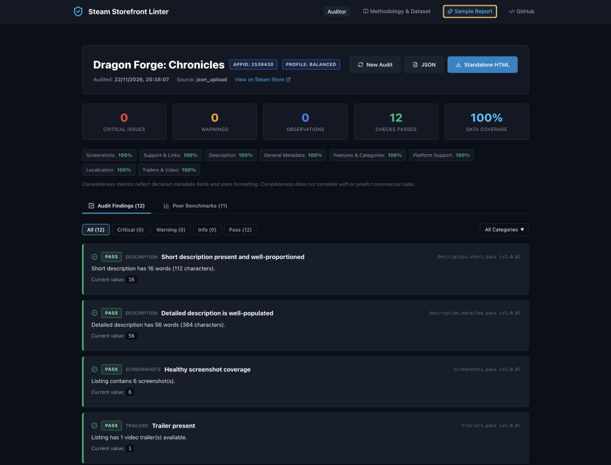
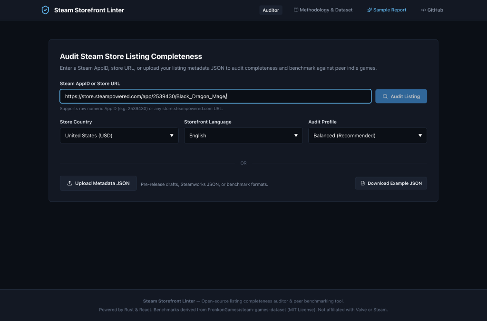
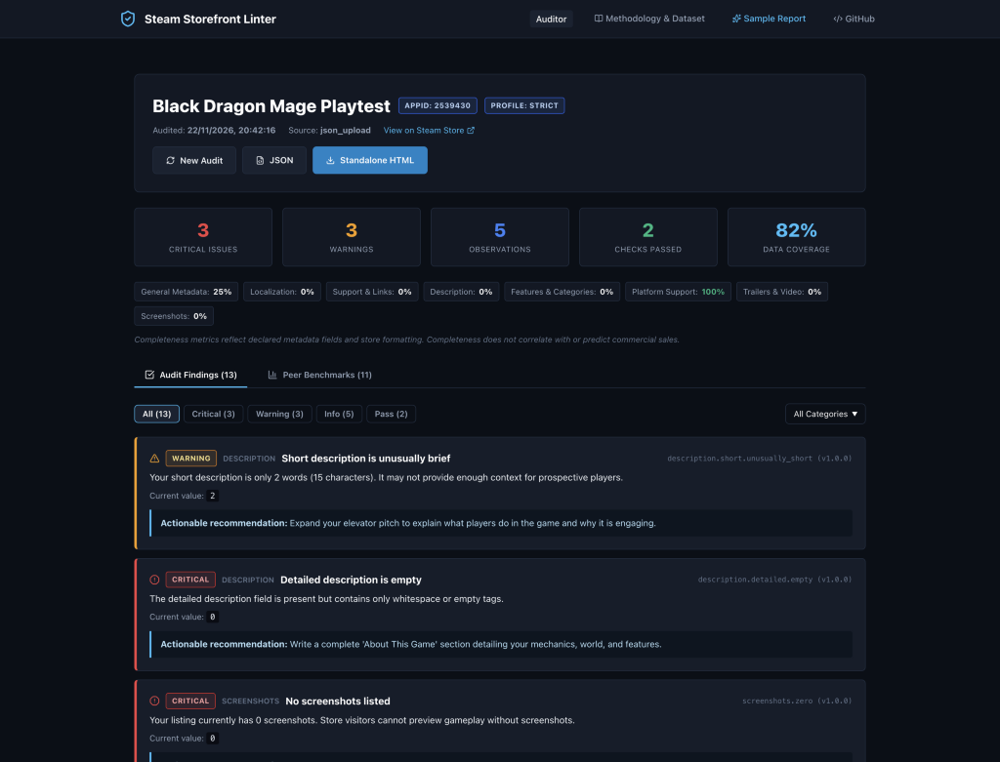
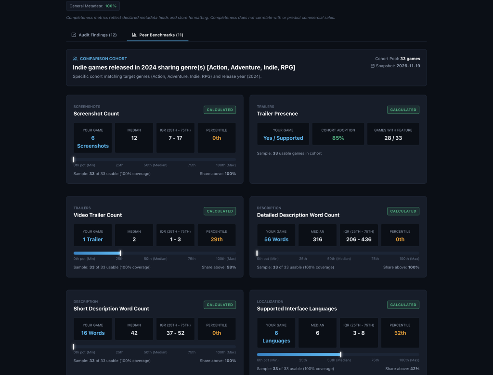
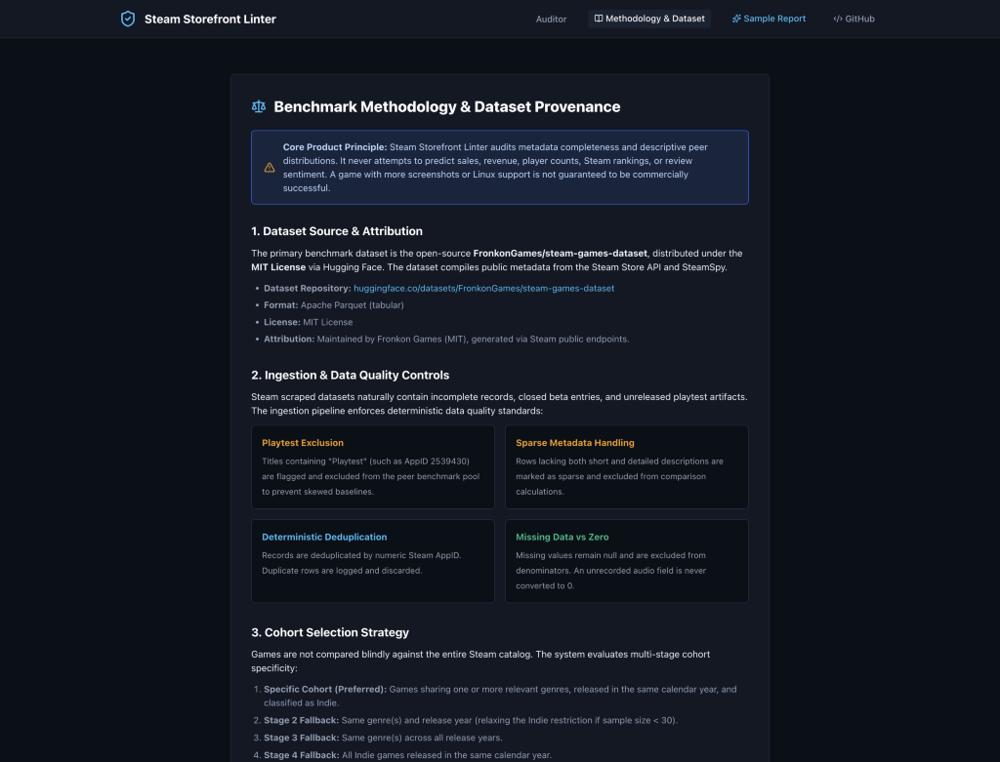
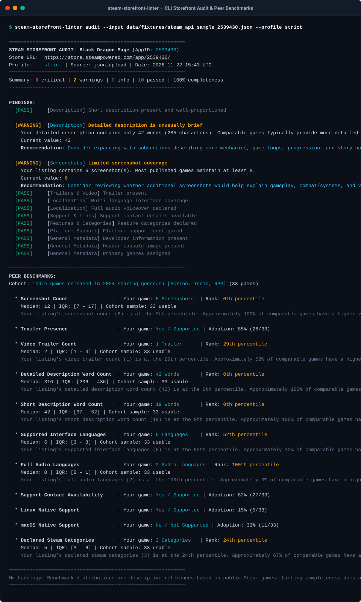
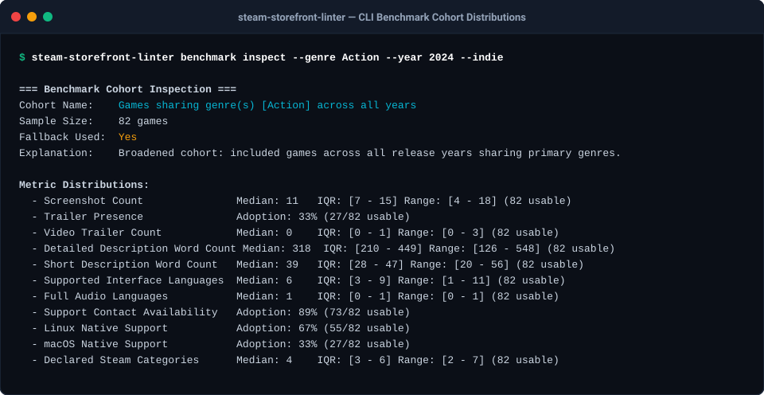

# Steam Storefront Linter

[](./LICENSE)
[](https://www.rust-lang.org/)
[](https://react.dev/)

> **A deterministic store listing completeness auditor and peer benchmarking tool for independent game developers.**

Steam Storefront Linter audits the completeness of Steam store listings before and after publication. It inspects metadata, descriptions, media assets, localization tables, support links, and platform compatibility, and benchmarks those attributes against comparable peer titles from the public [FronkonGames/steam-games-dataset](https://huggingface.co/datasets/FronkonGames/steam-games-dataset).


_The web application auditing a store listing across 8 core metadata categories with section coverage scores and structured rule evaluations._

---

> ### ⚠️ Important Product Scope
>
> **Steam Storefront Linter is a metadata completeness auditor, not a game-success predictor.**
>
> It does **not** predict game sales, units sold, player counts, Steam rankings, or review scores. A game with 15 screenshots is not inherently better than one with 6, and Linux native support does not guarantee sales. Descriptive benchmarking provides peer context so developers can see how their store presence compares with peer titles in their genre and release window.

---

## Features

- **Multi-Source Input:** Audit using a numeric Steam AppID, a store URL (e.g. `https://store.steampowered.com/app/2539430/`), or an uploaded listing metadata JSON file (supports pre-release drafts, raw Steam `appdetails` payloads, and normalized listing schemas).
- **Deterministic Audit Engine:** Rule-based verification across 8 core categories with structured findings, severity badges (`Critical`, `Warning`, `Info`, `Pass`), field-level evidence, and actionable recommendations.
- **Rule Profiles:** Supports `Balanced` (conservative thresholds) and `Strict` (higher standards for launch readiness, such as requiring 8+ screenshots and 100+ detailed description words).
- **Peer Benchmarking:** Compares your listing against peer cohorts (matching genres, release year, and indie classification) using actual percentile distributions (median, interquartile range, percentile rank, and share of comparable games with higher values).
- **Missing Data Integrity:** Preserves the distinction between present, empty, and unknown data. Missing values are never falsely converted into zeroes.
- **Reproducible Dataset Ingestion:** Ingests the public Parquet dataset, deduplicates records by AppID, and automatically flags and excludes transient playtest listings (e.g. AppID 2539430 playtest) and sparse records from benchmark cohorts.
- **Standalone Reports:** Export machine-readable JSON or self-contained, print-friendly HTML reports that open anywhere without a server.
- **Unified Engine:** The command-line interface (`steam-storefront-linter`), the HTTP API (`linter-server`), and the React web application invoke the exact same underlying Rust core (`linter-core`).

---

## Visual Showcase

### Web Application

#### 1. Storefront Input & Pre-Release JSON Upload

Enter any published Steam AppID or URL with customizable regional store country, storefront language, and audit profile—or upload local metadata JSON files before your store page goes live.



#### 2. Strict Profile Audit & Actionable Findings

Filter audit findings by severity (`Critical`, `Warning`, `Info`, `Pass`) or category. Each non-passing finding includes the exact inspected value alongside an actionable recommendation for Steamworks Store Admin.



#### 3. Peer Cohort Benchmarking & Percentile Distributions

Compare numerical and categorical listing metrics against automatically matched indie peer cohorts, complete with median, IQR (25th–75th percentile), percentile rank bars, and feature adoption rates.



#### 4. Methodology & Dataset Provenance

Built-in documentation of the 5-stage cohort fallback policy, data quality exclusions, and statistical conventions.



---

### Command-Line Interface (CLI)

#### Full Listing Audit & Peer Benchmarking (`steam-storefront-linter audit`)



#### Cohort Distribution Inspection (`steam-storefront-linter benchmark inspect`)



---

## Architecture

```text
steam-storefront-linter/
├── apps/
│   └── web/                   # React 19 + TypeScript + Vite frontend
├── crates/
│   ├── linter-core/           # Domain models, parser, rules engine, benchmarking, SQLite DB, report generation
│   ├── linter-server/         # Axum HTTP API & static asset server with rate-limiting & caching
│   └── linter-cli/            # Command-line interface (`steam-storefront-linter`)
├── data/
│   ├── raw/                   # (gitignored) Raw Parquet dataset from Hugging Face
│   ├── processed/             # (gitignored) Ingested SQLite benchmark database & manifest
│   └── fixtures/              # Tracked test fixtures (JSON & sample records)
└── docs/
    ├── screenshots/           # Web UI & CLI visual demonstrations
    └── *.md                   # Architectural, benchmark, API, and schema documentation
```

For in-depth architectural details, see [docs/architecture.md](./docs/architecture.md).

---

## Quick Start

### Prerequisites

- [Rust](https://www.rust-lang.org/tools/install) (1.80+)
- [Node.js](https://nodejs.org/) (20+)
- [pnpm](https://pnpm.io/) (9+)

### Installation

```bash
git clone https://github.com/LaymanMax/steam-storefront-linter.git
cd steam-storefront-linter

# Install frontend dependencies
pnpm install

# Initialize local sample benchmark database (215 eligible games across 11 genres)
cargo run -p linter-cli -- dataset sample
```

### Running the Web Application

#### Option A: Full-Stack Development Mode

```bash
# Terminal 1: Start Rust backend server (listens on http://127.0.0.1:3000)
cargo run -p linter-server

# Terminal 2: Start Vite frontend server (runs on http://localhost:5173 with API proxy)
pnpm --filter web dev
```

#### Option B: Self-Hosted Production Mode

```bash
# Build web frontend and run unified Rust server
pnpm --filter web build
cargo run --release -p linter-server
# Open http://127.0.0.1:3000 in your browser
```

---

## CLI Usage

The CLI binary is named `steam-storefront-linter`.

### 1. Audit a Listing

```bash
# Audit by numeric Steam AppID
steam-storefront-linter audit 2539430

# Audit by Steam store URL
steam-storefront-linter audit "https://store.steampowered.com/app/2539430/Black_Dragon_Mage/"

# Audit local JSON metadata (normalized schema or Steam appdetails response)
steam-storefront-linter audit --input data/fixtures/valid_indie_game.json
steam-storefront-linter audit --input data/fixtures/steam_api_sample_2539430.json --profile strict

# Export standalone HTML report
steam-storefront-linter audit --input data/fixtures/steam_api_sample_2539430.json --format html --output report.html

# Output JSON for CI/CD scripting (exits with code 1 if critical findings are present)
steam-storefront-linter audit --input data/fixtures/valid_indie_game.json --format json
```

### 2. Dataset Management

```bash
# Initialize offline sample benchmark database (215 eligible games, 5 excluded playtest/sparse rows)
steam-storefront-linter dataset sample

# Download the full 190MB Parquet dataset from Hugging Face
steam-storefront-linter dataset download

# Ingest and normalize Parquet data into SQLite benchmark database
steam-storefront-linter dataset ingest

# Inspect dataset metadata, row counts, and top genres
steam-storefront-linter dataset inspect

# Validate database integrity and index coverage
steam-storefront-linter dataset validate
```

### 3. Benchmark Inspection

```bash
# Check benchmark system status
steam-storefront-linter benchmark status

# Inspect metric distributions (Median, IQR, Range, and Adoption %) for a specific cohort
steam-storefront-linter benchmark inspect --genre Action --year 2024 --indie
```

---

## HTTP API Endpoints

When `linter-server` is running (default `http://127.0.0.1:3000`), all endpoints are served under `/api/v1`:

| Method | Endpoint                        | Description                                                                  |
| :----- | :------------------------------ | :--------------------------------------------------------------------------- |
| `GET`  | `/api/v1/health`                | Server health check, version, and uptime                                     |
| `POST` | `/api/v1/audits/steam/:app_id`  | Audit a live Steam listing (`?country=us&language=english&profile=balanced`) |
| `POST` | `/api/v1/audits/import`         | Audit an uploaded JSON listing payload (`?profile=balanced\|strict`)         |
| `GET`  | `/api/v1/audits/sample-report`  | Generate a complete sample audit report                                      |
| `GET`  | `/api/v1/audits/example`        | Download an example listing metadata JSON template                           |
| `GET`  | `/api/v1/audits/:audit_id`      | Retrieve a cached audit report by UUID                                       |
| `GET`  | `/api/v1/audits/:audit_id/json` | Download the audit report as a formatted `.json` attachment                  |
| `GET`  | `/api/v1/audits/:audit_id/html` | Download a self-contained `.html` report                                     |
| `GET`  | `/api/v1/benchmarks/status`     | Check benchmark SQLite database availability and metadata                    |
| `GET`  | `/api/v1/benchmarks/cohort`     | Inspect cohort metrics (`?genre=Action&year=2024&indie=true`)                |

See [docs/api.md](./docs/api.md) for request and response payloads.

---

## Audit Rules

The audit engine evaluates store pages across 8 essential categories:

1. **Description Completeness:** Checks short description word/char counts, detailed description ("About This Game") depth, placeholder text detection ("Lorem Ipsum", "Coming soon", "TBD").
2. **Screenshot Completeness:** Validates screenshot counts against standard thresholds (5 in Balanced, 8 in Strict), detects missing URLs and duplicate uploads.
3. **Trailers & Video:** Checks trailer presence and video counts (informational; trailers are not penalized as failures).
4. **Localization Coverage:** Measures interface languages, full audio voiceover declarations, and footnote markup.
5. **Support Information:** Validates availability of dedicated support URLs, support email addresses, and website links.
6. **Features & Categories:** Audits declared Steam categories (Single-player, Controller support, Steam Cloud, Achievements).
7. **Platform Support:** Explicitly reports Windows, macOS, and Linux support.
8. **General Metadata:** Audits developer studio name, publisher, header capsule image (460x215px), primary genres, and release date.

For full rule explanations and threshold configurations, see [docs/audit-rules.md](./docs/audit-rules.md).

---

## Benchmark Methodology

- **Cohort Selection:** Uses a 5-stage fallback algorithm matching primary genres, release year, and indie classification. When sample sizes are small, cohorts broaden transparently with explicit disclosure.
- **Minimum Sample Threshold:** Requires at least 30 usable records per metric. Tiny samples are flagged as `insufficient_sample` rather than producing misleading percentages.
- **Percentile Convention:** Calculates linear rank interpolation:
  $$\text{Percentile Rank} = \frac{\text{count}(\text{value} < v) + 0.5 \times \text{count}(\text{value} = v)}{\text{total usable records}} \times 100$$
- **Dataset Attribution:** Derived from the MIT-licensed `FronkonGames/steam-games-dataset`.

For detailed documentation, see [docs/benchmark-methodology.md](./docs/benchmark-methodology.md).

---

## Docker & Self-Hosting

A multi-stage `Dockerfile` and `docker-compose.yml` are provided for turnkey containerized deployment:

```bash
# Build and run with Docker Compose
docker compose up -d

# Check server health
curl http://localhost:3000/api/v1/health
```

The web interface will be available at `http://localhost:3000`.

---

## Testing

```bash
# Run all Rust unit and integration tests
cargo test --lib --workspace
cargo test --tests --workspace

# Run frontend tests with Vitest
pnpm --filter web test

# Check code formatting
cargo fmt --check

# Run Rust and TypeScript linters
cargo clippy --workspace --tests
pnpm --filter web lint
```

---

## Documentation Index

- [Architecture Overview](./docs/architecture.md)
- [Benchmark Methodology](./docs/benchmark-methodology.md)
- [Dataset Ingestion Pipeline](./docs/dataset-ingestion.md)
- [Audit Rules Reference](./docs/audit-rules.md)
- [HTTP API Reference](./docs/api.md)
- [Report Schema Reference](./docs/report-schema.md)
- [Local Development Guide](./docs/development.md)
- [Security & Privacy Policy](./docs/security.md)

---

## Attribution

- **Benchmark Data:** Sourced from [FronkonGames/steam-games-dataset](https://huggingface.co/datasets/FronkonGames/steam-games-dataset) under the MIT License.
- **Disclaimer:** Steam and the Steam logo are trademarks and/or registered trademarks of Valve Corporation in the U.S. and/or other countries. Steam Storefront Linter is an independent open-source project and is not affiliated with, endorsed by, or associated with Valve Corporation.


## License & Custom Work

[](mailto:work@withrana.com) [](https://www.linkedin.com/in/workwithrana)
[](https://www.upwork.com/freelancers/~01bbcf6edb91a8df5f)
[](https://contra.com/ranajahanzaib/)

**License:** MIT, see [LICENSE](LICENSE). Free for personal and commercial use.

**Author:** Rana Jahanzaib (aka LaymanMax)

**Need this built for your stack?** Email me what you're working on: work@withrana.com
